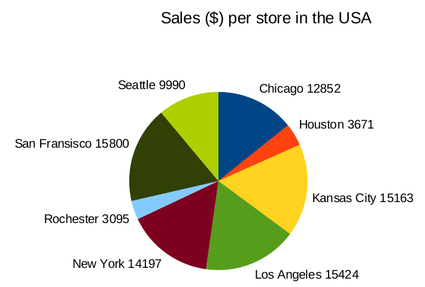

# Pivot Table Assignment: Home Appliances Retailer

All pivot tables are in the accompanying workbook (*Pivot_Table_Assignment_Solution.xlsx*), one tab per question. Sales figures are the sum of **Actual Price** (the price the customer paid). Q1–Q7 use the data as supplied (2,339 transactions); Q8–Q11 use the data after the region rename and the 12 added rows (2,351 transactions). Store, city and country names are spelled as they appear in the data.

## Question 1: How much in $ did you sell in each city?

Pivot: **Store** in Rows, **Sum of Actual Price** in Values. Moscow was the strongest store and Rochester the weakest.

| City (store) | Sales | City (store) | Sales |
|---|---:|---|---:|
| Amsterdam | $14,850 | Madria | $17,477 |
| Athens | $11,167 | Mexico City | $11,917 |
| Bangalore | $16,255 | Moscow | $21,083 |
| Bangkok | $13,302 | New York | $14,197 |
| Berlin | $16,397 | Osaka | $14,835 |
| Birmingham | $12,568 | Paris | $16,374 |
| Bogota | $16,247 | Prague | $16,686 |
| Bucharest | $13,102 | Riyadh | $12,205 |
| Buenos Aires | $15,724 | Rochester | $3,095 |
| Cairo | $12,816 | Rome | $11,910 |
| Capetown | $15,686 | San Fransisco | $15,800 |
| Chicago | $12,852 | Santiago | $13,040 |
| Delhi | $16,552 | Sao Paolo | $13,051 |
| Dubai | $11,520 | Seattle | $9,990 |
| Dublin | $17,896 | Seoul | $15,677 |
| Guangzhou | $10,641 | Shanghai | $15,643 |
| Ho Chi Minh City | $10,698 | Shenzhen | $9,957 |
| Houston | $3,671 | Sydney | $14,886 |
| Istanbul | $12,263 | Tel Aviv | $15,277 |
| Jerusalem | $10,932 | Tijuana | $17,253 |
| Kansas City | $15,163 | Tokyo | $15,884 |
| Kuala Lumpur | $12,700 | Toronto | $11,938 |
| Lima | $11,257 | Vancouver | $4,653 |
| London | $16,987 | Vienna | $13,672 |
| Los Angeles | $15,424 | Warsaw | $14,846 |

**Total sales: $678,016** across 50 cities.

## Question 2: Per each home appliance item, how many items were sold by your company?

Pivot: **Item** in Rows, **Count of Item** in Values (each row of data is one item sold).

| Item | Items sold |
|---|---:|
| Air conditioner | 195 |
| Blender | 196 |
| Ceiling fan | 180 |
| Coffee grinder | 189 |
| Dishwasher | 174 |
| Iron | 239 |
| Microwave | 203 |
| Oven | 194 |
| Refrigerator | 184 |
| Toaster | 190 |
| Vacuum Cleaner | 196 |
| Washing Machine | 199 |
| **Total** | **2,339** |

Irons sold most often (239) and dishwashers least often (174).

## Question 3: Total revenue by item (rows) and region (columns)

Pivot: **Item** in Rows, **Region** in Columns, **Sum of Actual Price** in Values. NA covers the USA and Canada; LATAM covers Mexico, Brazil, Argentina, Chile, Columbia and Peru.

| Item | APAC | EMEA | LATAM | NA | Total |
|----------------|----------:|----------:|----------:|----------:|----------:|
| Air conditioner | $33,306 | $51,576 | $16,282 | $21,259 | $122,423 |
| Blender | $1,939 | $3,886 | $1,504 | $1,390 | $8,719 |
| Ceiling fan | $5,462 | $11,194 | $3,298 | $4,572 | $24,526 |
| Coffee grinder | $3,319 | $4,910 | $1,655 | $1,972 | $11,856 |
| Dishwasher | $16,220 | $40,105 | $11,890 | $8,990 | $77,205 |
| Iron | $1,633 | $2,682 | $944 | $1,204 | $6,463 |
| Microwave | $3,836 | $6,412 | $2,099 | $2,211 | $14,558 |
| Oven | $23,760 | $38,665 | $15,295 | $18,345 | $96,065 |
| Refrigerator | $36,610 | $66,030 | $19,170 | $18,420 | $140,230 |
| Toaster | $1,987 | $3,239 | $1,351 | $1,948 | $8,525 |
| Vacuum Cleaner | $9,238 | $20,143 | $7,249 | $7,136 | $43,766 |
| Washing Machine | $29,720 | $56,872 | $17,752 | $19,336 | $123,680 |
| **Total** | **$167,030** | **$305,714** | **$98,489** | **$106,783** | **$678,016** |

Refrigerators earned the most revenue and EMEA was the largest region, with about 45% of all sales.

## Question 4: Show only Microwave, Oven and Refrigerator, and remove NA

On the Q3 pivot, the **Item** filter keeps only Microwave, Oven and Refrigerator, and **NA** is unticked in the **Region** filter.

| Item | APAC | EMEA | LATAM | Total |
|---|---:|---:|---:|---:|
| Microwave | $3,836 | $6,412 | $2,099 | $12,347 |
| Oven | $23,760 | $38,665 | $15,295 | $77,720 |
| Refrigerator | $36,610 | $66,030 | $19,170 | $121,810 |
| **Total** | **$64,206** | **$111,107** | **$36,564** | **$211,877** |

## Question 5: Average discount % per salesperson in Columbia, ascending. Who is the best sales agent?

Pivot: **Country** as a report (external) filter set to Columbia, **Salesperson** in Rows, **Average of Discount %** in Values, sorted smallest to largest. Discount % = (List Price − Actual Price) ÷ List Price.

| Salesperson | Average discount | Sales in Columbia |
|---|---:|---:|
| Gary Percival | 6.83% | 2 |
| David Finnie | 8.16% | 6 |
| Sandra Rew | 10.00% | 2 |
| Russell Thorley | 10.52% | 7 |
| Alison Lazar | 10.75% | 5 |
| Paul Puri | 11.03% | 5 |
| Margaret Buck | 12.15% | 4 |
| Shelley Mannix | 12.81% | 3 |
| Lisa Manning | 14.70% | 5 |
| Ronald Curtis | 15.17% | 6 |
| Philip Mishra | 15.50% | 4 |
| Antony Westlake | 17.00% | 4 |
| Basil Nolan | 28.50% | 4 |
| **All Columbia sales** | **13.35%** | **57** |

**Best sales agent: Gary Percival.** He has the lowest average discount (6.83%), so his sales came closest to the list price and gave away the least margin. He made only two sales in Columbia, though. David Finnie (8.16% across six sales) is the most consistent low-discount seller.

## Question 6: Sales report by Region, Country and Store

Pivot: **Region**, **Country** and **Store** in Rows (tabular layout, so each field has its own column), **Sum of Actual Price** in Values, with Country and Store subtotals turned off.

| Region | Country | Store | Sales |
|---|---|---|---:|
| APAC | Australia | Sydney | $14,886 |
|  | China | Guangzhou | $10,641 |
|  |  | Shanghai | $15,643 |
|  |  | Shenzhen | $9,957 |
|  | India | Bangalore | $16,255 |
|  |  | Delhi | $16,552 |
|  | Japan | Osaka | $14,835 |
|  |  | Tokyo | $15,884 |
|  | Malaysia | Kuala Lumpur | $12,700 |
|  | South Korea | Seoul | $15,677 |
|  | Thailand | Bangkok | $13,302 |
|  | Vietnam | Ho Chi Minh City | $10,698 |
| EMEA | Austria | Vienna | $13,672 |
|  | Czech Republic | Prague | $16,686 |
|  | Egypt | Cairo | $12,816 |
|  | France | Paris | $16,374 |
|  | Germany | Berlin | $16,397 |
|  | Greece | Athens | $11,167 |
|  | Ireland | Dublin | $17,896 |
|  | Israel | Jerusalem | $10,932 |
|  |  | Tel Aviv | $15,277 |
|  | Italy | Rome | $11,910 |
|  | Netherlands | Amsterdam | $14,850 |
|  | Poland | Warsaw | $14,846 |
|  | Romania | Bucharest | $13,102 |
|  | Russia | Moscow | $21,083 |
|  | Saudi Arabia | Riyadh | $12,205 |
|  | South Africa | Capetown | $15,686 |
|  | Spain | Madria | $17,477 |
|  | Turkey | Istanbul | $12,263 |
|  | UAE | Dubai | $11,520 |
|  | UK | Birmingham | $12,568 |
|  |  | London | $16,987 |
| LATAM | Argentina | Buenos Aires | $15,724 |
|  | Brazil | Sao Paolo | $13,051 |
|  | Chile | Santiago | $13,040 |
|  | Columbia | Bogota | $16,247 |
|  | Mexico | Mexico City | $11,917 |
|  |  | Tijuana | $17,253 |
|  | Peru | Lima | $11,257 |
| NA | Canada | Toronto | $11,938 |
|  |  | Vancouver | $4,653 |
|  | USA | Chicago | $12,852 |
|  |  | Houston | $3,671 |
|  |  | Kansas City | $15,163 |
|  |  | Los Angeles | $15,424 |
|  |  | New York | $14,197 |
|  |  | Rochester | $3,095 |
|  |  | San Fransisco | $15,800 |
|  |  | Seattle | $9,990 |
| **Total** |  |  | **$678,016** |

## Question 7: Show the Q6 pivot by Region only, without removing any field

Collapse the Region field. Right-click any Region label and choose **Expand/Collapse → Collapse Entire Field** (Microsoft, n.d.-b), or click the **−** button beside each region. Country and Store stay in the Rows area but are hidden, so **Expand Entire Field** brings them straight back.

| Region | Sales |
|---|---:|
| APAC | $167,030 |
| EMEA | $305,714 |
| LATAM | $98,489 |
| NA | $106,783 |
| **Total** | **$678,016** |

## Question 8: Combine NA and LATAM into "Americas"

In the data, select the **Region** column and use **Find & Replace** with *Match entire cell contents* ticked: replace `NA` with `Americas`, then `LATAM` with `Americas` (745 rows in total). Matching the entire cell means only cells that read exactly NA or LATAM change. Then refresh the pivot (**PivotTable Analyze → Refresh**).

| Region | Sales |
|---|---:|
| Americas | $205,272 |
| APAC | $167,030 |
| EMEA | $305,714 |
| **Total** | **$678,016** |

Americas = NA ($106,783) + LATAM ($98,489) = $205,272, so no sales were lost in the rename.

## Question 9: Add the 12 omitted APAC and EMEA transactions

The 12 rows were pasted directly under the last row of data (rows 2,341–2,352), in the same column order. Discount % was not typed in. It is calculated as (List Price − Actual Price) ÷ List Price, which gives the same values as the sheet. A pivot does not pick up new rows below its source range by itself, so the source was widened with **PivotTable Analyze → Change Data Source** to `Data!$A$1:$I$2352`, and the pivot was refreshed (Microsoft, n.d.-a). Formatting the data as an Excel Table first (Ctrl + T) would make future rows join the pivot automatically on refresh.

| Region | Before (Q8) | Added | After (Q9) |
|---|---:|---:|---:|
| Americas | $205,272 | $0 | $205,272 |
| APAC | $167,030 | $764 | $167,794 |
| EMEA | $305,714 | $637 | $306,351 |
| **Total** | **$678,016** | **$1,401** | **$679,417** |

The five APAC rows add $764 and the seven EMEA rows add $637, which confirms that all 12 transactions are included.

## Question 10: Pie chart of $ sales per store in the USA

Pivot: **Country** as a report filter set to USA, **Store** in Rows, **Sum of Actual Price** in Values, plotted as a pie chart (**PivotTable Analyze → PivotChart → Pie**).

| Store | Sales | Share |
|---|---:|---:|
| Chicago | $12,852 | 14.2% |
| Houston | $3,671 | 4.1% |
| Kansas City | $15,163 | 16.8% |
| Los Angeles | $15,424 | 17.1% |
| New York | $14,197 | 15.7% |
| Rochester | $3,095 | 3.4% |
| San Fransisco | $15,800 | 17.5% |
| Seattle | $9,990 | 11.1% |
| **Total** | **$90,192** | **100%** |

{ width=4.2in }

San Fransisco, Los Angeles and Kansas City each bring in about 17% of US sales. Houston and Rochester together make up less than 8%.

## Question 11: Add a slicer that filters the chart by Item

Click inside the Q10 pivot table, go to **Insert → Slicer**, tick **Item** and click **OK** (Microsoft, n.d.-c). The slicer is connected to the pivot table, and the PivotChart is built on that pivot table. So clicking an item in the slicer, for example *Refrigerator*, redraws the pie to show only that item's sales per US store. Holding Ctrl selects several items, and the *Clear Filter* button on the slicer shows all items again.

## References

Microsoft. (n.d.-a). *Change the source data for a PivotTable*. Microsoft Support. https://support.microsoft.com/en-us/office/change-the-source-data-for-a-pivottable-afd93524-f7de-432c-84d0-3896fbbc2577

Microsoft. (n.d.-b). *Expand, collapse, or show details in a PivotTable or PivotChart*. Microsoft Support. https://support.microsoft.com/en-us/office/expand-collapse-or-show-details-in-a-pivottable-or-pivotchart-d70d7e70-d230-4d45-81db-1f5e39bcb394

Microsoft. (n.d.-c). *Use slicers to filter data*. Microsoft Support. https://support.microsoft.com/en-us/office/use-slicers-to-filter-data-249f966b-a9d5-4b0f-b31a-12651785d29d
